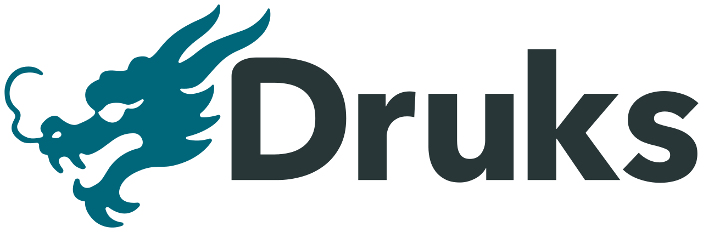

  <a href="https://druks.ai">
    <picture>
      <source media="(prefers-color-scheme: dark)" srcset="https://raw.githubusercontent.com/getdruks/.github/main/profile/assets/logo-dark.svg">
      
    </picture>
  </a>

<h2 align="center">AI agents work. You make the call.</h2>

  AI agents that build and run software for your company. 
  Your tools. Your approvals. Self-hosted or Druks Cloud.

  <a href="https://druks.ai">Website</a> ·
  <a href="https://app.druks.ai/sign-in">Try Druks Cloud</a> ·
  <a href="https://docs.druks.ai">Documentation</a> ·
  <a href="https://github.com/getdruks/druks">Source code</a>

Druks runs agent apps that connect to your tools and carry out repeatable work.
The apps bring important decisions to you and keep a record of each run.

The main [Druks repository](https://github.com/getdruks/druks) contains the platform,
the dashboard, and the Software Factory app for ticket-to-pull-request work.
The [app author guide](https://docs.druks.ai/writing-an-app) explains how to build your own apps.

Druks is under active development. The [repository README](https://github.com/getdruks/druks#readme)
contains the current installation steps and release status.
